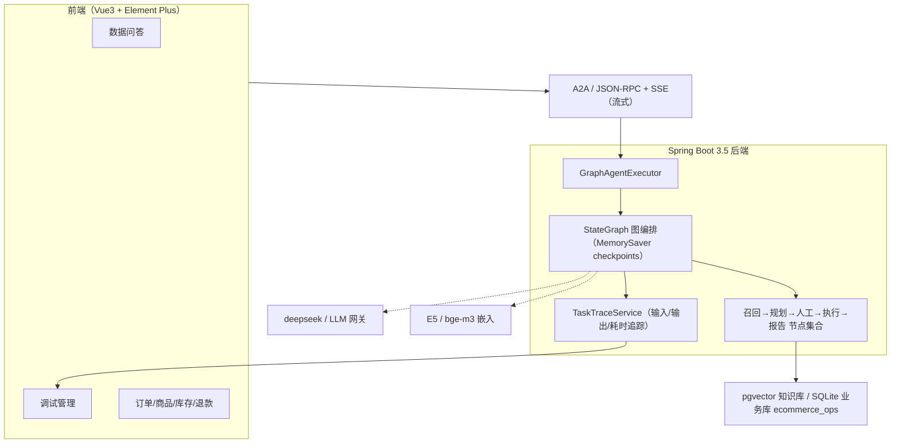

# 电商经营数据智能问答（Data Agent）· 讲稿

> 配套说明：本文档是“代码讲解 + 汇报”讲稿，含架构图/流程图与带注解的核心代码步骤。可结合文档内 Mermaid 图谱（Typora/VS Code + Mermaid 插件）直接演示。

---

## 一、开场与定位（口语可直接念）

大家好，今天给大家讲一套我做的电商经营数据智能问答系统，代号 Data Agent。
它的价值一句话：**让运营和客服用“人话”问数据，系统自动完成从语义理解、出 SQL、执行、到生成报告的全流程，并且每一步都安全、可追溯、可人工把关。**

演示案例：在对话框输入“查5月销售额最高的店铺”，系统会召回表结构、规划步骤、生成并执行 SQL、输出报告；如果开了“人工确认”，还会在动手前先停下来问你一句。

---

## 二、系统架构（先放架构图）



**讲稿要点**（对着图讲）：
- ① 用户在前端 Vue 提问；后端不是“一问一答”的 if-else，而是一张**有状态的图（StateGraph）**。
- ② 节点之间通过条件边迁移，可以**中断（等人工确认）、回环（计划被打回重做）**。
- ③ 每个节点外面包了追踪器，自动记录输入输出，所以有调试页看**每一步在干什么、花了多久**。
- ④ 数据层面：业务库 + 向量知识库分离，大模型只管“想”，取数走真实 SQL。

---

## 三、一次问答的完整流程图

```mermaid
flowchart TD
  A["用户提问"] --> B["证据召回 EvidenceRecall"]
  B --> C["Schema 召回"]
  C --> D["表关系 TableRelation"]
  D --> E{可行性评估 Feasibility}
  E -- "非数据分析" --> Z["结束/交上层Agent"]
  E -- "数据分析类" --> F["规划器 Planner"]
  F --> G{"人工确认 HITL"}
  G -- 开HITL --> G1["中断，等用户同意"]
  G1 -- 同意 --> H
  G1 -- 拒绝/给反馈 --> F
  G -- 关/自动 --> H["计划执行 PlanExecute（循环）"]
  H --> I{"下一步用"
  I -- SQL --> J["SQL生成"] --> K["SQL执行(安全+脱敏)"]
  I -- Python --> M["Python生成/执行/分析"]
  I -- 报告 --> P["报告生成 ReportGenerator"]
  K --> H
  M --> H
  P --> R["完成，返回报告"]
```

**讲稿要点**：
- 关键字是**“规划 + 执行”**：规划器先想清楚要做哪几步，执行器循环一步步跑完。
- 中间插了一个**人工确认关卡**，默认可关可开——这就是 HITL（Human-in-the-Loop）。

---

## 四、核心代码逻辑 step by step（重点，带注解）

### Step 1 · 执行入口：GraphAgentExecutor（A2A 的 AgentExecutor）

```java
// 前端每次发消息都会走到这里，messages 走 A2A 协议进来
public void execute(RequestContext context, EventQueue eventQueue) {
    TaskUpdater taskUpdater = new TaskUpdater(context, eventQueue);

    // 1) 读 metadata：人工确认是否开启（默认开，只有显式 false 才关）
    Object hitl = context.getMessage().getMetadata().get(HUMAN_IN_THE_LOOP);
    boolean humanInTheLoop = !Boolean.FALSE.equals(hitl); // 兜底：不传就当开

    // 2) 编译图：开启人工确认就在“人工确认”节点前设置中断+checkpoint
    CompileConfig config;
    if (humanInTheLoop) {
        config = CompileConfig.builder()
            .saverConfig(SaverConfig.builder().register(saver).build())
            .interruptBefore(Node.HUMAN_FEEDBACK)   // 关键：跑到这就暂停
            .build();
    } else {
        config = CompileConfig.builder()
            .saverConfig(SaverConfig.builder().register(saver).build())
            .build();
    }
    CompiledGraph compiledGraph = stateGraph.compile(config); // 编译成可执行图

    Message message = context.getMessage();

    // 3) 关键分支：任务已存在 => 恢复中断（人工确认后续传）
    Task existing = message.getTaskId()==null ? null : taskStore.get(message.getTaskId());
    if (existing != null) {
        RunnableConfig cfg = RunnableConfig.builder().threadId(existing.getId()).build();
        // 把用户“同意/反馈”写回 state，再用 null 输入恢复（stream(null,...)）
        compiledGraph.updateState(cfg,
            Map.of(CONFIRMATION_APPROVED, meta(CONFIRMATION_APPROVED),
                   CONFIRMATION_FEEDBACK, meta(CONFIRMATION_FEEDBACK)));
        CompletableFlux(compiledGraph.stream(null, cfg), taskUpdater, ...);
        return;
    }

    // 4) 没有 taskId => 新建任务，注入初始 state
    Task newTask = newTask(message);
    eventQueue.enqueueEvent(newTask);
    Map<String,Object> initial = new HashMap<>();
    initial.put(Input.USER_INPUT, 取text());                 // 用户问题
    initial.put(Input.ROLE,        metadata("role"));        // 运营/坐席
    initial.put(Input.DATABASE_ID, metadata(DATABASE_ID));
    initial.put(Input.MULTI_TURN_CONTEXT, 汇总历史对话());   // 多轮上下文
    initial.put(Input.HUMAN_IN_THE_LOOP, humanInTheLoop);
    CompletableFlux(compiledGraph.stream(initial, newCfg), taskUpdater, ...);
}
```

**讲一句**：这段决定了“开 HITL 会停下来、追问会开新任务”这两个非常关键的行为，是整套系统的入口大脑。

---

### Step 2 · 图装配：GraphConfiguration（节点 + 连线，声明式）

```java
@Bean
public StateGraph graph(...所有节点...) {
    // 每个键定义合并策略：Replace=直接覆盖（避免数组累加污染）
    Map<String,KeyStrategy> ks = new HashMap<>();
    ks.put(Input.USER_INPUT, new ReplaceStrategy());
    ks.put(Recall.EVIDENCE, new ReplaceStrategy());
    // ...其余 state 键同理

    return new StateGraph(GRAPH_NAME, ()->ks, serializer)
        // 所有节点统一包一层追踪器：记录输入/输出/耗时
        .addNode(Node.EVIDENCE_RECALL,      new TracedNodeAction(evidenceRecallNode,...))
        .addNode(Node.SCHEMA_RECALL,        new TracedNodeAction(schemeReCallNode,...))
        .addNode(Node.FEASIBILITY_ASSESSMENT,new TracedNodeAction(feasibilityAssessmentNode,...))
        .addNode(Node.PLANNER,              new TracedNodeAction(plannerNode,...))
        .addNode(Node.HUMAN_FEEDBACK,       new TracedNodeAction(humanFeedbackNode,...))
        .addNode(Node.PLAN_EXECUTION,       new TracedNodeAction(planExecuteNode,...))
        .addNode(Node.SQL_GENERATION,       new TracedNodeAction(sqlGeneratorNode,...))
        .addNode(Node.SQL_EXECUTION,        new TracedNodeAction(sqlExecuteNode,...))
        .addNode(Node.PYTHON_GENERATION,    new TracedNodeAction(pythonGeneratorNode,...))
        .addNode(Node.REPORT_GENERATION,    new TracedNodeAction(reportGeneratorNode,...))

        // 顺序边：召回阶段线性推进
        .addEdge(START, Node.EVIDENCE_RECALL)
        .addEdge(Node.EVIDENCE_RECALL, Node.SCHEMA_RECALL)
        .addEdge(Node.SCHEMA_RECALL, Node.TABLE_RELATION)
        // 条件边：可行性/人工/计划执行三个分支
        .addConditionalEdges(Node.FEASIBILITY_ASSESSMENT, new FeasibilityAssessmentEdge(),
            Map.of(Node.PLANNER, Node.PLANNER, END, END))
        .addConditionalEdges(Node.HUMAN_FEEDBACK, new HumanFeedbackEdge(),
            Map.of(END, END, Node.PLAN_EXECUTION, Node.PLAN_EXECUTION,
                   Node.PLANNER, Node.PLANNER))
        .addConditionalEdges(Node.PLAN_EXECUTION, new PlanExecutorEdge(),
            Map.of(Node.SQL_GENERATION, Node.SQL_GENERATION,
                   Node.PYTHON_GENERATION, Node.PYTHON_GENERATION,
                   Node.REPORT_GENERATION, Node.REPORT_GENERATION, END, END));
}
```

**讲一句**：图是“数据 + 逻辑”的解耦，新增一个分析工具，只需加一个节点和一条边，业务代码不用大改。

---

### Step 3 · SQL 执行：SqlExecuteNode（安全 + 脱敏）

```java
public Map<String,Object> apply(OverAllState state) {
    Integer step  = state.value(Planning.CURRENT_STEP, 1);
    String  sql   = state.value(Execution.SQL_GENERATION_RESULT, "");
    String  dbId  = state.value(Input.DATABASE_ID, "");

    // ---- 第一道安全线：只读 SQL 强校验 ----
    SqlSecurityValidator.Result sec = SqlSecurityValidator.validate(sql); // 禁 DROP/ALTER/DELETE/TRUNCATE...
    if (!sec.allowed) {
        log.warn("[SQL_SECURITY] 拦截 sql={} reason={}", sql, sec.reason);
        return failure(step, "[安全管理] " + sec.reason); // 不执行，只回写失败结果
    }

    // ---- 真正只读执行：PreparedStatement 防注入 ----
    SqlResultSet rs;
    try (Connection c = DataSourceProvider.INSTANCE.get(dbId).getConnection();
         PreparedStatement ps = c.prepareStatement(sql);
         ResultSet r = ps.executeQuery()) {
        rs = ResultSetBuilder.buildFrom(r);
    } catch (Exception e) {
        return failure(step, "SQL 执行失败: " + e.getMessage()); // 异常也不抛，写回结果
    }

    // ---- 第二道线：权限脱敏 ----
    rs = permissionInterceptor.mask(rs); // 手机号/收货地址等敏感列打码

    // 记录执行结果供报告节点使用（step_1 / step_2 ... 序列）
    Map<String,String> exec = new HashMap<>();
    exec.put("step_" + step, JsonUtil.toJson(rs));
    Map<String,Object> out = new HashMap<>();
    out.put(Planning.CURRENT_STEP, step + 1);
    out.put(Execution.SQL_EXECUTION_RESULT, rs);
    out.put(Planning.EXECUTION_OUTPUT, exec);
    return out;
}
```

**讲一句**：失败不抛异常而是回写结果，是为了让下游（报告/追踪）还能生成“可解释”的失败说明，而不是整个流程崩掉。

---

### Step 4 · 人工确认：HumanFeedbackNode（HITL 的分支逻辑）

```java
public Map<String,Object> apply(OverAllState state) {
    Boolean hitl = state.value(Input.HUMAN_IN_THE_LOOP, true);
    if (!Boolean.TRUE.equals(hitl)) {
        // 没开人工确认：直接放行去执行计划
        return Map.of(HumanReview.NEXT_NODE, Node.PLAN_EXECUTION);
    }
    Integer count = state.value(Planning.REPAIR_COUNT, 1); // 记录“被驳回了几次”
    if (count >= 3) return Map.of(HumanReview.NEXT_NODE, END); // 驳回超过3次：叫停，防止死循环

    Boolean approved = state.value(HumanReview.CONFIRMATION_APPROVED, false);
    if (Boolean.TRUE.equals(approved)) {
        return Map.of(HumanReview.NEXT_NODE, Node.PLAN_EXECUTION); // 用户同意 => 执行计划
    }
    // 用户拒绝 => 带反馈回炉重规划，并累计驳回次数
    String fb = state.value(HumanReview.CONFIRMATION_FEEDBACK, "");
    Map<String,Object> o = new HashMap<>();
    o.put(HumanReview.NEXT_NODE, Node.PLANNER);
    o.put(Planning.REPAIR_COUNT, count + 1);
    o.put(HumanReview.CONFIRMATION_FEEDBACK, fb.isEmpty() ? "Plan rejected by user" : fb);
    return o;
}
```

**讲一句**：人工确认不是“可选项装饰”，它真正改变图的分支走向：同意→执行，拒绝→带反馈回炉，最多 3 次防止死循环。

---

### Step 5 · 计划执行：PlanExecuteNode（多步循环的“调度器”）

```java
public Map<String,Object> apply(OverAllState state) {
    Plan plan = Plan.getPlan(state);
    int step = state.value(Planning.CURRENT_STEP, 1);
    List<PlanStep> steps = plan.getExecutionPlan();

    if (step > steps.size()) {                       // 所有步骤都跑完了
        boolean lastIsReport = !steps.isEmpty() &&
            Node.REPORT_GENERATION.equals(steps.get(steps.size()-1).getToolToUse());
        // 结束：保证“跑完必有报告”（若计划漏了报告步骤，强制路由到报告节点）
        return Map.of(NEXT_NODE, lastIsReport ? END : Node.REPORT_GENERATION);
    }
    // 还有步骤：返回当前步要用哪个工具（SQL 还是 Python）
    return Map.of(NEXT_NODE, steps.get(step - 1).getToolToUse());
}
```

**讲一句**：这就是“循环”的实现——每次执行完一步，图又回到计划执行节点，直到下标越界才收尾进报告。

---

### Step 6 · 调试追踪：TracedNodeAction（火焰图的原料）

```java
public CompletableFuture<Map<String,Object>> apply(OverAllState state) {
    String taskId = state.value(Input.TRACE_TASK_ID, "unknown");
    // 开始前：记录这一步的输入（完整 state 快照）
    TraceFrame f = traceService.start(taskId, nodeName, null);
    f.setInputDetail(summarize(state.data()));       // 输入 => 前端节点面板展示

    return delegate.apply(state).handle((re, err) -> {
        if (err != null) {                            // 失败：记录异常，不抛
            traceService.finish(f, "error");
            f.setOutputDetail("执行异常: " + err.getMessage());
            return null;
        }
        traceService.finish(f, "success");           // 成功：记录耗时与输出
        f.setOutputDetail(summarize(re));            // 输出 => 构成调用树/火焰图
        return re;
    });
}
```

**讲一句**：NodeName/Status/Duration/ParentId 组合起来，就是调试页火焰图和调用树的全部数据来源；这也是“全链路可追踪”的根基。

---

## 五、多轮上下文 & 前端配合

1. 多轮：前端每次发送拼 `用户/助手历史` 进 `MULTI_TURN_CONTEXT`，后端在第 4 步注入 state；追问在前端 completed 后清掉 taskId，从而“开新任务但继承上文”。
2. 人工确认：前端收到 `input-required` 弹确认面板，点提交后再带同一 taskId 续传；开关值写入 `humanInTheLoop` metadata。
3. 调试页：DebugManage 调 ``/trace/tasks/{id}``，渲染火焰图（滚轮缩放/拖拽）+ 调用树 + 节点输入输出 + 耗时排行。

---

## 六、收尾（可直接念）

总结起来，这套系统有三个我比较看重的点：
一是``编排``——用 StateGraph 把“召回/规划/人工/执行/报告”串成可中断、可回环的图，而不是僵化的流程；
二是``安全可控``——只读 SQL 校验 + 权限脱敏 + 人工确认 + 全链路追踪，让 AI 干活“看得见、拦得住、查得清”；
三是``可演进``——前端 A2A 接入天然可以作为子 Agent 被上层客服系统调用。

我的分享就到这里，谢谢大家。

---
