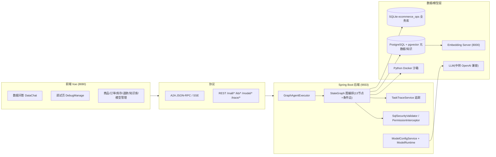
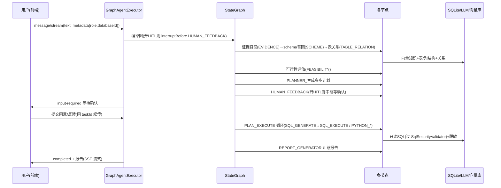

# 电商经营数据智能问答（Data Agent）· 面试八股文

> 配套项目：`data-agent-tutorial`（电商经营数据 Text2SQL 智能问答系统）
> 适合场景：简历项目介绍 / 技术面 / 深挖细节 / 反问加分。建议先背「项目速览」，再按「核心八股问答」逐条理解。

---

## 一、项目速览（背熟）

1. **一句话**：这是一个基于 **StateGraph 图编排 + Spring AI 大模型 + A2A 协议** 的电商数据问答 Agent，把自然语言提问变成可执行的“多步数据分析计划”，走 `召回 → 规划 → NL2SQL → 执行 → 报告` 流水线产出结果，并内置只读安全、权限隔离/脱敏、人工确认（HITL）与全链路调试追踪。
2. **使用者**：① 店铺运营——查销售额/GMV、商品销量、访客转化、退款率、活动核销、库存与排行榜；② 客服坐席——查单个买家历史订单、售后、消费汇总（强制单买家维度）。
3. **输入/输出**：输入自然语言问题（带 `databaseId`、`role` 等 metadata），输出结构化报告（文本 + 表格/图表），SSE 流式返回。
4. **关键能力**：NL2SQL、双通道检索（结构化 schema + 向量化知识）、SQL 安全与脱敏、Human-in-the-Loop 确认、模型在线配置、反馈沉淀知识库、火焰图/调用树调试、A2A 可作为子 Agent 被上层调用、Docker 一键部署。

### 技术栈速记
| 层 | 技术 |
|---|---|
| 前端 | Vue 3 + TypeScript + Vite + Element Plus（Nginx 托管，:8080） |
| 后端 | Java 21 + Spring Boot 3 + Maven（:9933） |
| 图编排 | `spring-ai-alibaba-graph-core`（StateGraph + MemorySaver checkpoint） |
| LLM | Spring AI OpenAI 兼容通道（可换任意中转，默认 deepseek 系，流式） |
| 向量库 | PostgreSQL + `pgvector`（HNSW / cosine） |
| 演示业务库 | SQLite（`ecommerce_ops`：店铺/商品/订单/买家/退款/活动） |
| Embedding | 本地 `embedding-server`（:8000，`intfloat/multilingual-e5-large`） |
| ORM/数据访问 | MyBatis-Plus（业务） + JdbcTemplate + Jimmer 方言 |
| 集成 | `a2a-java-sdk-transport-jsonrpc`（A2A JSON-RPC / SSE） |
| 部署 | Docker Compose：PG/Redis/Embedding/Python 沙箱/后端/前端 6 服务 |

---

## 二、整体架构

**要点**：
- 前后端通过 **A2A 协议（JSON-RPC + SSE）**通信，天然支持被上层“客服主 Agent”当作**子 Agent**远程调用；业务管理走普通 REST。
- 后端核心不是一串 if-else，而是一张**有状态 StateGraph**：一条 ThreadId 配一个 `MemorySaver` checkpoint，可中断/恢复（HITL 靠它）。
- 每个图节点被 `TracedNodeAction` 包装，自动记录输入/输出/耗时/状态，供前端 DebugManage 渲染火焰图与调用树。
- Embedding 是独立的本地服务（`embedding-server`），后端经 `.env`/配置指向其地址，方便替换模型。

---

## 三、端到端流程

**一句话流程**：`证据/Schema/表关系召回 → 可行性评估 → 规划 → 人工确认(可选) → 计划执行(SQL/Python) → 报告生成 → 流式返回`；全程每节点打 trace。

---

## 四、核心八股问答

### Q1 · 用一段话介绍你的项目？
一个基于 StateGraph 状态图编排 + Spring AI 大模型 + A2A 协议的电商经营数据问答系统。用户用自然语言提问（如“查 6 月销售额最高的两个店铺，给出 GMV”），系统自动完成“语义/知识召回 → 可行性评估 → 规划 → NL2SQL → 安全执行 → 报告”全流程，同时内置多轮上下文、权限隔离与脱敏、人工确认（HITL）和全链路调试追踪。前端 Vue3+Element Plus，后端 Java21 + Spring Boot3，数据层用 PostgreSQL(pgvector) 做向量检索、SQLite 做演示业务库，整套用 Docker Compose 一条命令拉起。

### Q2 · NL2SQL 为什么不是一步直接生成？
一步生成准确率、可解释性和安全性都差。拆成多步、每步一个图节点：
1. `EvidenceRecallNode` 召回业务知识与指标口径（glossary/question knowledge）；
2. `SchemeReCallNode` 召回表/列结构，`TableRelationNode` 召回表关系；
3. `FeasibilityAssessmentNode` 判断是否数据分析类问题，不是则直接结束（避免浪费 Token）；
4. `PlannerNode` 把问题拆成多步可执行计划；
5. `SqlGeneratorNode`+`SqlExecuteNode` 每步生成并安全执行 SQL；
6. `ReportGeneratorNode` 汇总成报告。
好处：每步可观测、可中断、可人工确认、出错可定位到具体节点。

### Q3 · 为什么用 StateGraph，而不是手写 if-else 流程？
- **有状态、可 checkpoint**：配 `MemorySaver` 保存每个 threadId 的 state，天然支持中断/恢复——这是 HITL 的地基。
- **条件边声明式表达分叉/回环**：可行性→规划→人工→执行这种“条件跳转/回炉重规划”用条件边写比硬编码 if-else 更清晰、更易扩展节点。
- **可观测**：节点之间隔离、可统一包 `TracedNodeAction` 打点，出问题好定位。
- 代价是概念和 debug 成本略高，但换来可维护性与灵活性。

### Q4 · 人工确认 HITL 怎么实现？
编译图时若开启人工确认，就设置 `interruptBefore(HUMAN_FEEDBACK)` 并注册 `MemorySaver`。图在人工确认节点前中断并保存 checkpoint；前端收到 `input-required` 展示确认面板；用户提交后仍用**同一 taskId**（带 `confirmationApproved`/`Feedback`）上传，后端走 `existingTask != null` 分支 `updateState + stream` 恢复继续。`HumanFeedbackNode` 根据同意/拒绝决定直接执行计划，还是回炉重新规划（有次数上限，防死循环）。

### Q5 · SQL 只读安全怎么保证？
执行前统一走 `SqlSecurityValidator.validate(sql)`：只允许 SELECT，拦截 DROP/ALTER/DELETE/TRUNCATE/多语句等危险写法；不通过直接返回 `{status:failed, reason}`，**不执行、不抛异常**，把风险挡在 SQL 落地前。生产再加第二道防线：用只读数据库账号/连接 + PreparedStatement，避免越权写操作。

### Q6 · 权限隔离与脱敏怎么做？
请求 metadata 带 `role`（运营/坐席）。`PermissionInterceptor` 在查询前按角色修正/拒绝 WHERE 与表范围：**运营只能看所属店铺，客服只能查指定单买家**；结果再统一过 `mask(resultSet)` 对手机号、收货地址等敏感字段脱敏；越权直接拦截，并落审计日志（操作人、问题、生成语句、耗时、结果条数）。

### Q7 · 火焰图/调用树是怎么做出来的？
每个图节点用 `TracedNodeAction` 包装：开始记录输入，结束写回输出与 `duration/status` 到 `TaskTraceService` 的 `TraceFrame`；`parentId` 构成调用树，`startMs/durationMs` 构成火焰图数据。`TraceController` 暴露接口，前端 DebugManage 按 parentId 分深度、按 startMs 排位置、按 durationMs 比宽度渲染。

### Q8 · 为什么协议用 A2A？
设计目标是能被上层“客服主 Agent”远程调用、作为**子 Agent**复用。A2A 提供标准化 `message/stream`、`task`、`input-required` 等语义，流式事件天然能表达“思考中/结果/待人工/完成”状态，跨系统、跨语言复用。超出数据类的问题（如退货办理）也会返回标识，交由上层主 Agent 处理。

### Q9 · “双通道检索”具体指什么？
同一问题同时走两条召回通道，再合并交给 LLM：
- **结构化通道**：`db_table/db_column/db_foreign_key` 元数据，召回表与列结构、表关系，让 LLM 知道有哪些表和字段；
- **语义通道**：`glossary_knowledge`（业务词表/指标口径）+ `question_knowledge`（问答示例）向量化后，经 pgvector(HNSW) 语义召回。
两者结合显著降低 SQL 幻觉（编造不存在的表/列、口径错误）。

### Q10 · 向量检索与 Embedding 是怎么接的？
启动时 `EcommerceSchemaInitializer` 把演示库的表/列/外键写入 PG 元数据表并对知识向量化；Embedding 由独立服务 `embedding-server`（e5-large）出向量，`pgvector` 用 HNSW + cosine 近似检索。模型地址与维度都走配置/环境变量，便于替换模型（换模型一般需重建 `vector_store`）。

### Q11 · 数据源怎么对接？
抽象出 `SchemaDataSourceProvider`，按 `databaseId` 返回可写连接：演示用 SQLite(`ecommerce_ops`、`knowledge_base`)，生产可按 `05-数据源对接规范` 新增 MySQL 只读 Provider 或数据中台 API。SQL 方言可切换（`new-sql-generate.st` 的 `{dialect}` 参数）。

### Q12 · 慢查询/异常怎么兜底？
每条流请求有整体超时（`.timeout + blockLast`），超时或异常时写一条“watchdog”兜底报告文案而不是无声失败；高频大统计可加限流；数据库/接口异常返回标准化兜底话术；模型不可用时报错并提示检查 Key，不虚构数据。

### Q13 · 模型管理（LLM + Embedding）为什么做成可在线配置？
模型配置（kind/name/provider/base_url/api_key/model_name/dimensions/enabled）存到 PG `model_profile` 表，`ModelRuntime` 运行时按配置构建 `OpenAiApi` 客户端。好处：改模型/换 Key 不用改代码重新发版，前端“模型管理”页即可增删改，避免把 Key 写死在仓库里。

### Q14 · 反馈怎么沉淀成知识？
`QaFeedbackController` 记录 `qa_feedback` + 点赞/点踩（`qa_feedback_vote`）；点赞数达到阈值（`qa.feedback.promote-threshold`，默认 3）后自动把该问答 `promote` 写入 `question_knowledge`，成为后续可召回的“证据”，形成“问答 → 反馈 → 知识沉淀 → 更好召回”的正向闭环；点踩会 `demote` 降权。

### Q15 · schema 入库 / 数据资产页是怎么实现的？
`EcommerceSchemaInitializer` 在 `ApplicationRunner` 里启动时检查 PG 的 `db_table` 是否已有 `database_id=ecommerce_ops`，没有则读取演示库结构，把表/列/外键写入元数据表并向量化；`SourceAssetController` 提供 `/asset/summary` 等接口给前端“数据资产”页展示表/字段/关系。

### Q16 · 全栈是怎么 Docker 化编排的？
`docker-compose.yml` 编排 6 个服务：
- `postgres`（pgvector/pgvector:pg18，挂载 `./database.sql` 到 `initdb.d` 做初始化 + 健康检查）；
- `redis`（已提供，当前核心链路暂未强依赖，为后续缓存/限流预留）；
- `embedding-server`（FastAPI e5-large，:8000）；
- `python-sandbox`（Python 分析沙箱镜像，后端经 `DATA_AGENT_PYTHON_DOCKER_IMAGE` 通过宿主 `/var/run/docker.sock` 调用）；
- `backend`（:9933，环境变量覆盖数据源/模型地址/Key，健康检查 `/asset/summary`）；
- `frontend`（Nginx 托管，:8080，代理 `/api` 到后端）。
模型 Key 通过根目录 `.env` 注入，避免硬编码。

### Q17 · 多轮上下文（MultiTurn / Resume）怎么区分？
带同一 `taskId` 且后端任务仍存在 = **Resume（恢复中断）**，用于 HITL 确认续跑；不带 taskId = **新建任务**。前端在任务 completed 后清掉 taskId（保留 contextId），保证“追问”开新任务而不是误当恢复。`MULTI_TURN_CONTEXT` 状态保留筛选条件供下一轮继承，切换主题会重置。

### Q18 · 测试环境与生产环境的差异化安全？
测试用 SQLite 演示库、允许本库读写；生产强制：MySQL 只读账号 / 数据中台 API、仅 SELECT、敏感脱敏+审计、越权拦截+操作日志、全表扫描拦截（强制 WHERE/limit）、限流、结构化埋点日志、知识库存 PG+权限管理。模型 Key/口令一律走 KMS/环境变量，禁止硬编码。

---

## 五、高频细节速记

1. **为什么报告有时是“本次查询已完成”？** 报告节点未产出可解析的 report 文本时前端走兜底文案；Python 沙箱超时也会中断数据链导致报告为空。
2. **MemorySaver 存哪？** 内存（演示）。生产可换外部 checkpoint 存储，便于多实例横向扩展与共享。
3. **为什么 HITL 要前后端双端控制？** 前端决定是否带 argument；后端 `Boolean.FALSE.equals(...)` 兜底（默认开），前端不传也保证安全和可用。
4. **SQL 只读怎么做“二道防线”？** 校验器第一道挡危险语句；只读连接/账户 + PreparedStatement 第二道；异常只回结果不抛异常、不伪造。
5. **越权为什么能防住？** role → 拦截器在查询前修正/拒绝 WHERE 与表范围，结果再 mask 敏感列，并打日志。
6. **换 Embedding 模型后要注意什么？** `spring.ai.vectorstore.pgvector.dimensions` 与 `initialize-schema`；维度变了建议删 `vector_store` 重建，避免向量维度不一致查询失败。
7. **这个 Agent 怎么被上层调用？** 走 A2A `message/send`，带 `databaseId`/`role`；非数据分析类问题返回标识，由上层主 Agent 继续。
8. **为什么有 `trace` 模块？** 面试官关心可观测性：节点级耗时、输入输出、父子链，前端可视化，线上定位“卡在哪个节点/哪句 SQL”。

---

## 六、加分点 / 反问面试官

- 强调“**安全优先**”：LLM 生成的 SQL 不可信，必须先校验再执行——这是本项目区别于纯 Demo 的关键工程点。
- 强调“**可扩展数据源**”：不绑定单库，`SchemaDataSourceProvider` 按 `databaseId` 路由，生产可接 MySQL/中台。
- 强调“**反馈闭环**”：点赞自动沉淀知识，系统越用越准（promote threshold）。
- 反问可提：团队目前是否已经用向量库/Agent 编排？数据权限模型怎么设计？便于展示思考深度。

---

## 七、关联文档

- README：项目目录、配置、架构图（`README.md`）
- 架构讲稿（浏览器）：`docs/架构讲稿.html`
- 详细规范：`docs/01-架构设计-模块划分.md`、`docs/02-系统提示词.md`、`docs/04-SQL安全与权限代码模板.md`、`docs/05-数据源对接规范.md`、`docs/06-测试与生产安全差异化.md`
